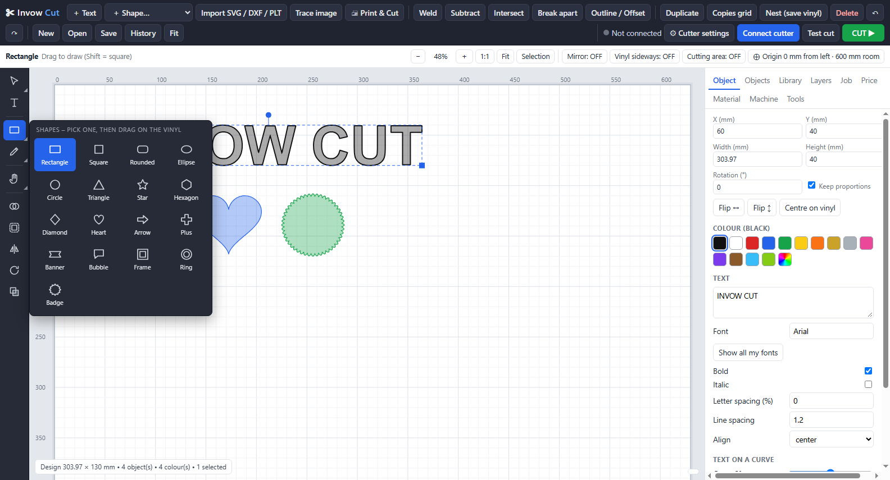

# Invow Cut

**Developed by INVOW MALDIVES**

**Vinyl cutter software that runs in your browser.** Design stickers, signs and heat-transfer vinyl and cut them directly on a USB vinyl cutter. You don't need to install anything: it is a single HTML file that uses Web Serial in Google Chrome or Microsoft Edge, on Windows and Mac.

It was built for and tested on a **630 mm "Cutter type 630" vinyl cutter** (USB, FTDI serial chip, DMPL language). It should also work with other DMPL cutters after you check the settings.

## Features

### Design
- **Text** in any font installed on your computer, including **text on a curve or full circle**
- **Shapes:** rectangle, square, rounded rectangle, circle, ellipse, triangle, star, hexagon, diamond, heart, arrow, plus, banner, speech bubble, frame, ring, badge
- **Pen tool**, **Points tool** (move, add or delete points) and **Knife tool** (slice a shape in two)
- **Weld, Subtract, Intersect, Break apart**
- **Outline / Offset** for sticker borders
- **Trace image:** turns a PNG or JPG logo into cut lines
- **Import** SVG (each colour becomes a layer), DXF and PLT/HPGL
- **Export** DXF and SVG

### Production tools
- **Colour layers:** cut one vinyl colour at a time, with alignment marks
- **Copies grid** and **Nest** to pack pieces tightly and save vinyl
- **Weed box** and **weeding lines** for faster weeding
- **Outline and shadow layers** (second colour behind text)
- **Stencil bridges:** keep the middles of O, A, B and similar letters attached
- **Names list / numbering:** one design becomes many copies (names, `001-050`, …)
- **QR code generator**
- **Tiling:** split a sign bigger than the vinyl into overlapping panels
- **Rhinestone templates:** stone holes along the outline or filling the shape
- **Print & Cut:** print with registration crosses, then cut the contour (manual alignment, no sensor needed)
- **Templates:** roll widths, paper sizes, sign sizes and ready-made sticker sheets
- **Mirror** for heat-transfer vinyl (the app asks when you choose an HTV material)

### Machine & safety
- **Cutter settings** window: connection, material presets, passes, overcut, **blade offset compensation**, size calibration and direction
- **Safety limits:** jobs wider or longer than your machine are **blocked before they are sent**, so the carriage can't hit the end of the rail
- **Origin position:** enter where the blade is when you press Origin, and the safe room is recalculated
- **Cutting area overlay** on the canvas: green when the design fits, red when it doesn't
- **Test cut:** a 20 mm square to check size and direction

### Shop
- **Price quote:** vinyl used, cut length and time, with your own prices and copyable quote text
- **Job history** with customer names: search, reopen or cut again
- Projects saved as `.vcut` files, plus automatic saving

## Getting started

1. Download this repository (green **Code** button → **Download ZIP**) and unzip it.
2. Open `InvowCut.html` in **Google Chrome** or **Microsoft Edge**.
   - Windows: you can also double-click `Start Invow Cut.bat`.
   - Mac: double-click `Start Invow Cut (Mac).command` (the first time: right-click → Open).
3. Plug in the cutter. Close any other cutting program, because only one program can use the cutter at a time.
4. Click **Connect cutter** and choose the cutter's serial port (on Windows e.g. "USB Serial Port (COM3)", on Mac "FT232R USB UART").
5. Load vinyl, lower the rollers, put the blade where you want to start and press **Origin** on the cutter.
6. Click **Test cut**. The square should measure **20 mm**. If it doesn't, use **⚙ Cutter settings → Fix size**.

## Cutter settings (630 cutter)

| Setting | Value |
|---|---|
| Language | DMPL |
| Baud rate | 38400, 8N1 |
| Handshake | Hardware (RTS/CTS) |
| Resolution | 40 steps per mm |
| Header | `;:H A L0` |
| Footer | `@ @` (the cutter only runs the job after this, then returns to Origin) |

The cutter sends no position or status information back. That's why every size and safety check happens in the app before the job is sent.

## Troubleshooting

- **"Port busy" / nothing happens:** another program still holds the port. Close other cutting software (some keep running in the background, so check Task Manager), or unplug the USB cable and plug it back in.
- **The cutter only makes a "tick" sound:** check that the header is `;:H A L0` in ⚙ Cutter settings → Advanced.
- **The cutter seems stuck:** switch it off and on again.
- **The design comes out mirrored or sideways:** ⚙ Cutter settings → Size & direction (Flip across / Flip feed).

## Requirements

- Google Chrome or Microsoft Edge (version 89 or newer), with Web Serial support
- Windows 10/11 or macOS
- A USB vinyl cutter that understands DMPL

## Files

| File | What it is |
|---|---|
| `InvowCut.html` | The whole app |
| `Start Invow Cut.bat` / `Start Invow Cut (Mac).command` | Launchers |
| `InvowCut.ico` | App icon |
| `Send-ToCutter.ps1` / `Send file to cutter.bat` | Backup way to send a saved cut file on Windows |
| `README.txt` | Short user guide |
| `InvowCut-v1-backup.html` | First version, kept for reference |

## License

[MIT](LICENSE): free to use, copy, change and share, including for commercial work. Keep the copyright notice. The software comes with no warranty: always test-cut on scrap vinyl and set the safety limits for your own machine.
